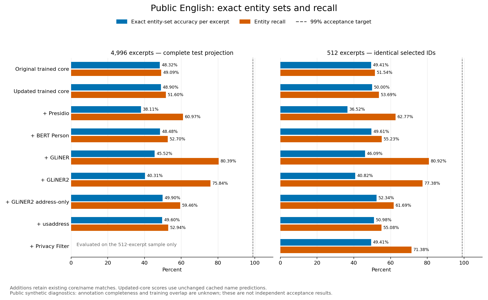

# Open-source PII research — 5 October 2026

The practical integrations in this research branch are portable international
phone metadata and a bounded subset of vendor-secret patterns. Contextual
English models remain experimental. No result here establishes the acceptance
target of 99% exact entity-set accuracy per excerpt and 99% entity recall per
primary stratum. No production deployment or public accuracy claim is implied.

The original detector baseline is commit
`9b711c06ed85509a14d435b421601a39ff848979`. Browser model comparisons use the
frozen trained extension captured before this slice's integrations. Core replays
reuse those exact contextual-name spans with the new WASM core; they do not
rerun the neural name model. Each aggregate records hashes of its private source
reports. Raw inputs, prediction caches, model weights and private corpora remain
outside Git.

## Initial model comparisons

These 100 authored synthetic excerpts were frozen before candidate inference.
They subsequently became model-selection data. Counts below are excerpts with
the complete typed entity set exactly correct, after adding nonoverlapping
candidate spans while retaining existing trained-detector matches.

| Composition | English general | English workplace | Mixed Icelandic/English |
| --- | ---: | ---: | ---: |
| Frozen trained detector | 25/40 | 27/36 | 22/24 |
| + Presidio | 27/40 | 30/36 | 15/24 |
| + BERT Person recognizer | 25/40 | 28/36 | 22/24 |
| + GLiNER FP32 | 31/40 | 27/36 | 12/24 |
| + GLiNER published QUInt8 | 30/40 | 26/36 | 11/24 |
| + GLiNER2 original | 32/40 | 26/36 | 21/24 |
| + external provider Privacy Filter | 33/40 | 32/36 | 18/24 |
| + Gravitee compact INT8 | 26/40 | 30/36 | 15/24 |
| + Gravitee compact FP32 | 26/40 | 30/36 | 14/24 |

Most broad additions regress mixed-language exact accuracy. The BERT control
adds only one exact workplace excerpt here and remains a large, incomplete PII
detector. None justifies replacing or enabling a broad default on this evidence.
See `initial-model-comparisons.json` for standalone, basic/trained composition,
per-type recall/precision and false-positive counts.

## Selected address supplement and structured integrations

GLiNER2 address-only at its original 0.5 threshold was selected before authoring
the separate 90-excerpt follow-up. On that follow-up, it changes English exact
accuracy from 32/60 to 40/60 and leaves mixed exact accuracy at 24/30. It adds 14
true spans and six false spans overall. This is a useful research direction,
not a default integration or independently annotated acceptance result.

The phone/vendor core with unchanged frozen contextual-name predictions changes
the initial set from 74/100 to 80/100 exact and the 90-excerpt follow-up from
56/90 to 61/90. In these general fixtures, the gain comes from phone coverage:
six added true spans and one fewer false span initially; five added true spans
and no added false spans on the follow-up. Every replay verifies exact
restoration. See the two `*-structured-replay.json` reports for all strata and
the separately scored experimental address supplement.

Gitleaks is a specialist secret comparator. Its initial comparison uses the
**phone-updated** baseline, so `gitleaks-phone-baseline-comparison.json` is kept
separate from the original-baseline model table. The aggregate exporter rejects
mixed baseline hashes rather than merging incompatible comparisons.

The dedicated vendor-token calibration set improves from 46/102 to 102/102
exact. This set was used during implementation and is not held-out evidence.
The separate 134-excerpt follow-up improves from 60 to 98 exact: 38 added true
spans and no added false spans. All 44 negatives remain exact; all 18 low-entropy
and 18 path-embedded token cases remain missed. The follow-up was retained
without using those misses to change the rule policy. The final trained WASM
matches native typed spans and restores exactly on all 236 fixtures. See
`vendor-specialist-calibration.json` and `vendor-specialist-followup.json` for
strata, paired changes and source/runtime hashes. These fabricated token-shaped
values are never issued or verified against a service.

On the separate 36-excerpt phone probe, exact excerpts increase from 18 to 33
and true spans from eight to 24, with false spans falling from two to one. All
18 explicit international-number excerpts become exact. Domestic-number
inference remains outside the new adapter: that stratum stays at one of four
exact, with three misses and one false span. The 14 boundary/control excerpts
are unchanged. `phone-specialist.json` includes final trained native/WASM parity
and exact restoration; these small synthetic probes do not establish field
accuracy or actual number assignment.

## Broader public English core replay

The pinned public synthetic test projection contains 4,996 excerpts and 6,421
in-scope gold spans. With unchanged cached contextual-name predictions, the
updated core changes trained exact excerpts from 2,414 to 2,443, true spans from
3,152 to 3,313, false spans from 2,714 to 2,701, and missed spans from 3,269 to
3,108. Recall rises from 49.09% to 51.60%; exact accuracy rises from 48.32% to
48.90%. Twenty-nine previously incorrect excerpts become exact and no previously
exact excerpt breaks. No previously correct projected gold span is lost.

These are broad synthetic diagnostic gains, not independent acceptance. Public
annotation completeness and overlap with model training are unknown. Negative
excerpts mean no projected in-scope labels, not an absence of all PII. See
`public-core-replay.json` and the
[conversion protocol](../../open-source-pii/external-english-protocol.md).

## Completed public model comparisons

The [SVG figure](public-model-tradeoffs.svg) and `public-model-tradeoffs.json`
retain exportable artwork and input/output hashes. It plots additive compositions
against the updated core; Privacy Filter has no full-set bar because only its
fixed sample completed.

The following compositions use the updated phone/vendor core and the original
cached contextual-name predictions on the same 4,996 test excerpts. Existing
core matches retain precedence over overlapping model additions. These are
diagnostic comparisons on public synthetic data, not independent acceptance.

| Composition | Exact excerpts / 4,996 | Entity recall | False spans |
| --- | ---: | ---: | ---: |
| Updated trained core | 2,443 | 51.60% | 2,701 |
| + Presidio | 1,904 | 60.97% | 4,734 |
| + BERT Person | 2,422 | 52.70% | 3,459 |
| + GLiNER | 2,274 | 80.39% | 4,643 |
| + GLiNER2 | 2,014 | 75.84% | 5,503 |
| + GLiNER2 address-only | 2,493 | 59.46% | 2,998 |
| + usaddress standalone parser | 2,478 | 52.94% | 2,836 |

Broad additions trade higher recall for lower complete-excerpt accuracy. The
address-only GLiNER2 supplement adds 505 true and 297 false spans and improves
50 exact excerpts; that false-positive cost does not justify enabling it by
default. GLiNER alone reaches 3,098 exact excerpts and 91.82% recall, but its
additive composition inherits existing errors and introduces others. This does
not validate replacing the current detector or selecting a language router.
The separate composition attribution report explains this overlap limitation.
`current-core-error-relations.json` further distinguishes typed boundary errors
from absent entity-span coverage. It records 736 false-name/address overlap pairs
and 633 partly covered address misses. These post-evaluation diagnostics do not
change labels, qualify a policy or prove that unlabelled text is benign.

external provider Privacy Filter was evaluated on a deterministic, outcome-independent
512-excerpt selection. All candidates below are rescored on those same IDs;
these counts must not be compared directly with the full-set counts above.

| Composition | Exact excerpts / 512 | Entity recall | False spans |
| --- | ---: | ---: | ---: |
| Updated trained core | 256 | 53.69% | 291 |
| + Presidio | 187 | 62.77% | 524 |
| + BERT Person | 254 | 55.23% | 370 |
| + GLiNER | 236 | 80.92% | 480 |
| + GLiNER2 | 209 | 77.38% | 600 |
| + GLiNER2 address-only | 268 | 61.69% | 327 |
| + usaddress standalone parser | 261 | 55.08% | 312 |
| + external provider Privacy Filter | 253 | 71.38% | 509 |

Privacy Filter completed this sample without inference failures in about 126
minutes on the shared CPU host, with roughly 4.1 GiB peak resident memory. Its
2.799 GB checkpoint and observed cost are unsuitable for the current extension
budget, and the additive quality result does not justify a default integration.
An earlier 22-excerpt public attempt and a 302-excerpt Icelandic attempt were
stopped for resource limits; neither is reported as a complete evaluation.
GLiNER2 completed the full public set with one malformed candidate response,
retained as an abstention rather than dropped from scoring.

The four `public-{original,current}-core-{full,sample}-models.json` aggregates
keep the two baselines and two sample sizes separate. In current-core reports,
the machine-readable `frozen-trained` run key denotes the updated core with
unchanged frozen name predictions, not the original core. Export validates
the corresponding reference hash. Raw text and per-excerpt predictions remain
private. The selection protocol and source revisions are recorded in the
[public English protocol](../../open-source-pii/external-english-protocol.md).

## Icelandic regression guard

The final trained WASM core was replayed with the same cached contextual-name
predictions on the two previously used Icelandic development sets. All 5,838
Person prediction/abstention sets are unchanged and every masked input restores
exactly. General development remains 5,503/5,582 exact (1,462 TP, 67 FP, 44 FN);
domain development remains 250/256 exact (474 TP, three FP, six FN).

This comparison isolates the core integration: it is Person-only, reused
development evidence, not independent validation, full-entity accuracy or a
fresh browser neural-inference run. The model-only reference has a different
general score because the existing core already adds one correct name. See
`icelandic-core-replay.json` for the paired aggregate and private-source hashes.
Blind Icelandic evaluation files were not opened for this comparison.
The selected runtime uses a 128 KiB stack; the earlier matching 256 KiB replay
is retained separately in `icelandic-core-stack256k-replay.json`.

## Runtime constraints

The structured core's selected 128 KiB stack passes both build profiles, all
49,245 geographic/random phone-rule cases, nine separate global-network
examples, 272 specialist fixtures, full cached-name English/Icelandic replays,
and trained browser workflows. This avoids the rules-only hang at 64 KiB with
less observed overhead than the initial 256 KiB fix. See
[the structured runtime record](../../open-source-pii/structured-runtime.md)
and `structured-runtime.json` for counts, hashes and timing limitations.

A later composition regression exposed an opaque vendor token when a phone or
card pattern inside it won overlap resolution. A validated complete vendor
token now takes precedence over strictly contained findings; surrounding or
equal-span findings and Unicode review retain their existing precedence.
This code-derived regression is covered by native, WASM and browser tests, plus
191,202 composition-fuzz executions. It is not a new blind quality result.
`final-runtime-validation.json` binds the immutable score reports above to the
final binaries: all replay records remain identical, all 272 specialist cases
agree with newly regenerated native results, and the final phone-rule audits
retain exact restoration and zero native/WASM span mismatches.

GLiNER2's FP32 ONNX export reproduces all original predictions on the reused
90-excerpt probe, but its NER graphs total about 1.219 GB. Two declared QUInt8
variants reduce that to about 365 MB and lower standalone exact excerpts from
66/90 to 51/90. The local browser version differs on four prediction sets and
scores 54/90. Both quantized variants are rejected for default use.

The publisher's GLiNER QUInt8 graph is about 197 MB. Compared with FP32, it
changes 21/100 initial and 17/90 follow-up prediction sets; standalone exact
counts fall from 67 to 61 and from 54 to 53 respectively. A local Chromium
prototype makes no external requests and completes 90 excerpts without failures,
but differs from native QUInt8 on six prediction sets and scores 52/90. Its
token IDs, word masks and original word offsets match Python on all 190 reused
synthetic inputs. Input parity does not imply inference parity or acceptable
quality. Neither prototype is imported by the dmz product.

## Validation-only address confidence selection

The published GLiNER QUInt8 model was separately evaluated on 4,995 public
synthetic validation excerpts. The threshold grid and decision rule were fixed
before inference: address-only detections needed at least 50 true positives and
a two-sided 95% Wilson lower precision bound of at least 0.99. No threshold
qualified. At 0.7 there were 1,027 true and 52 false spans; at 0.9 there were
83 true and five false spans; at 0.95 only one true span remained. All three
higher thresholds produced no address detections.

This rejects the declared confidence-only route; the guard was not relaxed and
no new default or follow-up was selected from it. The Wilson statistic on this
correlated synthetic data is a selection guard, not certified field precision
or evidence of the user's exact-excerpt/recall target. All fixed trials and
source hashes are retained in `address-confidence-selection.json`.

See the [survey](../../open-source-pii/survey.md),
[reproduction guide](../../open-source-pii/reproduce.md),
[next English experiment priorities](../../open-source-pii/next-english-work.md),
[GLiNER2 runtime record](../../open-source-pii/runtime-feasibility.md) and
[GLiNER runtime protocol](../../open-source-pii/gliner-runtime-protocol.md) for
pinned sources, licensing distinctions and evaluation limits.

The full public candidate comparisons and identical-sample Privacy Filter
evaluation are complete. A fresh browser run of the final product build also
completed all 4,996 excerpts in about 116 minutes on the shared host. Every name
prediction, typed basic/trained span, abstention and restoration result matches
the scored final core replay. It observed zero external requests and reused zero
checkpoint excerpts. `fresh-browser-validation.json` binds that fresh result to
the build, replay and published score hashes. The comparison tables retain their
cached-name method; the separate fresh run confirms the same product predictions.

Recovery was then exercised on a private copy of the completed checkpoint with
an extra uncommitted line. All 4,996 committed records were preserved and the
tail was discarded, with no new inference or external requests. Previously
tested tampered and truncated prefixes were rejected before browser launch.
`browser-checkpoint-validation.json` records those integrity checks separately;
the resumed run is not counted as a second fresh quality evaluation.
