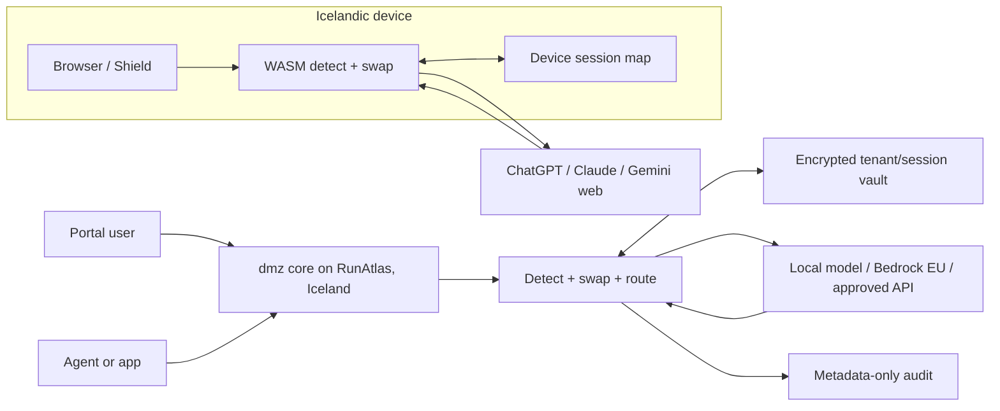

# Product and architecture specification, working v0.1

Source: 27 September 2026 business plan. Planned behaviour is marked here as requirements, not shipped functionality. The current repository is a scaffold.

## Principles

1. A single Go detector core serves server paths and compiles with TinyGo to WASM for Shield. Spike TinyGo in week 1. If infeasible, a TypeScript port must pass the same conformance corpus.
2. Direct identifiers and the per-session re-identification map remain on the user's device (Shield) or Icelandic RunAtlas infrastructure (Portal/Gateway). Model providers receive stand-ins.
3. Pseudonymisation does not guarantee anonymity; quasi-identifiers and detection misses remain risks.
4. Prompt and response bodies must never be written to gateway disk, logs, traces or audit records. Metadata-only audit: user, time, detected entity types, route and model.
5. Tenant policy determines `swap`, `warn` or `block` for each entity type. Uncertain Shield matches ask the user or block per policy. Uploads are blocked in phase 1.

## Surfaces and data flow

Shield never sends real prompt contents or its map to dmz servers. Portal and Gateway see real values transiently in the Icelandic core, then route pseudonyms. Staff retain their own ChatGPT/Claude subscriptions for ordinary work; dmz supplies an additional sensitive-work path. The source plan's Shield slogan “we cannot leak what we never see” is **Shield-only**; it cannot describe Portal or Gateway.

## Phase 1 detection inventory

| Entity | Initial rule | Acceptance concern |
| --- | --- | --- |
| Personal/legal kennitala | `DDMMYY-NNCM`, optional hyphen; weights 3,2,7,6,5,4,3,2 on first eight digits; check digit `11 - sum % 11`, with 11→0 and 10 invalid; legal day +40 | Validate actual date and century digit; synthetic tests use century digit 8 |
| Icelandic names | Mannanafnaskrá given names plus patronymics ending `-son`, `-dóttir`, `-bur`; BÍN case forms | Same-gender, same-case surrogate; licensed data cannot be committed yet |
| IS IBAN | `IS` + two check digits + 22 digits, mod-97 | 26 characters total |
| Payment card | 13–19 digits, Luhn | Avoid false positives on long IDs |
| Icelandic phone | optional `+354`, then seven digits | Local number ambiguity |
| Email | Syntax with conservative boundaries | Avoid exposing in text or logs |
| Street address | Street gazetteer, house number, three-digit postcode | Licensed address source and contextual precision |
| Secrets | Provider key prefixes, JWT, PEM, connection strings, high-entropy tokens | Gateway also flags log lines |
| Tenant dictionary | Client names, case numbers, project codenames | Per-tenant isolation and case handling |

Detector policy defaults currently live in [`packages/policy/default.json`](../packages/policy/default.json). They implement the plan's `swap` default, but a pilot may choose `block` for secrets and other high-risk entities.

## Surrogate and vault requirements

- A name becomes another name of the same gender in the same grammatical case, consistently within a session. Every mapped case form rehydrates correctly.
- Each tenant/session map links real value and stand-in. Envelope encryption uses a tenant key via OpenBao Transit. Customer-managed keys are a later option.
- Entries expire at session end or within 24 hours; the exact rule must be policy-controlled and documented. No prompt or response body persistence.
- Streaming rehydration needs a bounded buffer that handles token boundaries, overlapping stand-ins and partial outputs without emitting a wrong real value.
- Tests must cover cross-tenant leakage, same-session consistency, Unicode normalization, inflection, broken streams and vault expiry.

## Routing requirements

Sensitivity score plus tenant policy selects local model, Bedrock EU or an approved frontier API; a policy may forbid all external routes. Provider configuration must be tested per model/region/account. Bedrock retention mode `none` and any API ZDR right need evidence before a route is marketed accordingly. No consumer login or subscription-token pass-through.

Gateway should expose OpenAI- and Anthropic-compatible endpoints for OpenCode, Cline, Continue and scripts, with secret/log detection and metadata exports mapped to Stafrænt Ísland rules and later ISO 42001 evidence. The rules cover more than direct identifiers (including confidential material and case records) and allow requests for evidence of AI purpose, benefit and quality review. A metadata event alone is not proof of full compliance; the export must be designed with buyers and a manual evidence process. Connector gateway/MCP comes in phase 3. Shield should intercept input and submit events instead of relying on page layout; nightly tests on live supported sites catch interface changes.

## Platform stack

| Area | Chosen stack | Constraint |
| --- | --- | --- |
| Core, gateway, vault, audit | Go | Same detector source on server and WASM |
| Shield | WXT, TypeScript, Manifest V3 | Chrome, Edge, Firefox; live-site regression checks |
| Portal | SvelteKit over Go API | Sensitive-work lane and tenant admin |
| Docs | Astro Starlight | `docs.dmz.is` |
| Core hosting | RunAtlas, Iceland | Real values and keys remain in Iceland |
| Static marketing | separate `dmz-web`, Coolify | No customer prompt data |
| Vault key operations | OpenBao Transit | Tenant-key envelope encryption |
| Storage | Postgres initially; ClickHouse for audit at scale | Metadata only |
| DNS/analytics/status | Bunny.net, cookieless Rybbit, Uptime Kuma | No third-party trackers on marketing site |

## Phase 1 exclusions

- Files and images: block uploads to AI sites until document redaction exists.
- Desktop/mobile chat apps: managed-device blocking or a future connector gateway; Shield covers browser only.
- Any login pass-through or third-party use of ChatGPT/Claude subscription tokens.

## Benchmarks and release gates

Corpus: synthetic Icelandic examples only, including generated 1800s kennitölur (century digit 8). Compare default Presidio, regex-only, and dmz. Publish precision and recall per entity type and per release. A release must not lower recall for any entity type on the benchmark. Gate 2 targets **99% recall for kennitölur** and **95% for names** on the public benchmark; these are targets, not current results.

CI should include detector conformance tests (Go and WASM), benchmark no-regression gate, lint that rejects logging request/response bodies, secret scanning, SBOM per build, and signed reproducible Shield packages. Fetch licensed lexicon data during build only after licence approval; never commit it.

## Releases

| Version | Contents | Gate |
| --- | --- | --- |
| v0.1 | Detector core, synthetic benchmark and scorer, first public results | Gate 1 |
| v0.2 | Clickable Shield demo on chatgpt.com and claude.ai | Gate 1 |
| v1.0 | Shield GA, Portal on Bedrock EU, vault, audit | Gate 2 |
| v1.1 | Gateway GA, Stafrænt Ísland audit export | Gate 3 |
| v2.0 | Approved ZDR backends, connector gateway/MCP | Gate 4 |

## Open technical decisions

TinyGo feasibility and WASM size/performance; source and redistribution rights for BÍN and Mannanafnaskrá; postcode/street data licence; exact model routing matrix; OpenBao tenancy and key rotation; durable audit schema; direct vs proxied API credentials; browser interface interception reliability; retention evidence for each provider/model; reproducible extension signing.
