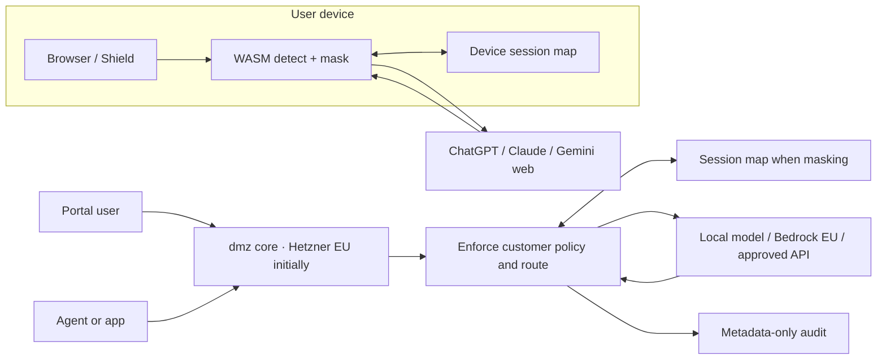

# Product and architecture specification, working v0.1

Source: 27 September 2026 business plan, with prototype decisions recorded in ADR 0002 and 0003. Planned behaviour is marked as a requirement; Shield's manual side panel, experimental ChatGPT/Claude content script and small Go/WASM detector are now implemented. The content script has synthetic browser-fixture coverage and owner-reported live masking on both sites and restoration on Claude; full authenticated verification remains pending.

Portal/Gateway direction was revised with owner approval in [ADR 0004](adr/0004-portal-hosting-and-pii-policy.md): initial Hetzner EU hosting and customer policy selecting masking or approved original-PII processing. See the [first preview plan](portal-gateway-plan.md). These are planned capabilities.

## Principles

1. A single Go detector core serves server paths and compiles with TinyGo to WASM for Shield. Spike TinyGo in week 1. If infeasible, a TypeScript port must pass the same conformance corpus.
2. Shield identifiers and mappings remain on device. Portal/Gateway masking keeps originals and mappings in the approved deployment boundary (initially Hetzner Germany/Finland); an explicitly approved PII route can process permitted originals at the provider. When masking is selected, providers receive visible masks, such as `⟦KT-<session>-1: XXXXX-XXXX⟧`.
3. Pseudonymisation does not guarantee anonymity; quasi-identifiers and detection misses remain risks.
4. Prompt and response bodies must never be written to gateway disk, logs, traces or audit records. Metadata-only audit: user, time, detected entity types, route and model.
5. Tenant policy will determine `mask`, `warn` or `block` for each entity type. The current prototype masks date-shaped uncertain kennitölur, blocks other uncertain matches and secrets, and offers no automatic upload interception. Its experimental text-submission interception is limited to selected ChatGPT/Claude DOM paths.

## Surfaces and data flow

Shield never sends real prompt contents or its map to dmz servers. Portal and Gateway process originals transiently within their approved deployment boundary, then send masked or permitted original data according to the enforced policy. The current content script keeps the map in an isolated per-tab WASM instance and displays restored replies in an extension-origin frame in place of the answer; the site DOM retains its masked text, hidden until reset. Browser tests check that the parent page cannot read the restored frame document or recover restored text through selection. Its submission DOM hooks can still be bypassed by site changes or unsupported send paths and are not yet a complete security boundary. Staff retain their own ChatGPT/Claude subscriptions for ordinary work; dmz supplies an additional sensitive-work path. The source plan's Shield slogan “we cannot leak what we never see” is **Shield-only**; it cannot describe Portal or Gateway.

## Phase 1 detection inventory

| Entity | Initial rule | Acceptance concern |
| --- | --- | --- |
| Personal/legal kennitala | `DDMMYY-NNCM`, optional hyphen; date, century and legacy mod-11 check; legal day +40 | Newer kennitölur may lack a calculated check digit, so plausible shape is uncertain and still masked; synthetic tests use century digit 8 |
| Icelandic names | Mannanafnaskrá given names plus patronymics ending `-son`, `-dóttir`, `-bur`; BÍN case forms | Visible masks for each detected case form; licensed data cannot be committed yet |
| IS IBAN | `IS` + two check digits + 22 digits, mod-97 | 26 characters total |
| Payment card | 13–19 digits, Luhn | Avoid false positives on long IDs |
| Icelandic phone | optional `+354`, then seven digits | Local number ambiguity |
| Email | Syntax with conservative boundaries | Avoid exposing in text or logs |
| Street address | Street gazetteer, house number, three-digit postcode | Licensed address source and contextual precision |
| Secrets | Provider key prefixes, JWT, PEM, connection strings, high-entropy tokens | Gateway also flags log lines |
| Tenant dictionary | Client names, case numbers, project codenames | Per-tenant isolation and case handling |

The planned policy schema lives in [`packages/policy/default.json`](../packages/policy/default.json); it has not been wired into the Shield prototype yet. The prototype uses the fixed behaviour in ADR 0002 and 0003. A tenant policy UI and enforcement still need to be built before a pilot.

Current implementation includes a device-local, exact, case-sensitive dictionary
of up to 32 user-entered terms. It is cleared on reset and does not provide the
planned tenant-admin workflow, inflection or per-tenant distribution. Selected
API-key, JWT, bearer-token, complete private-key-block and database-URL patterns are detected. Incomplete or mismatched private-key fences keep Shield’s whole-prompt masking fallback; complete blocks preserve surrounding prose.
General high-entropy-token and log-line detection remain unimplemented. Strict
core callers block secrets and most uncertain findings; Shield's owner-approved
best-effort policy masks them locally instead.

The basic core recognizes four hand-authored name forms and an uncertain
patronymic heuristic. The private trained preview adds a local CRF/neural name
scanner, whose [measured limits](detector-quality-contract.md) remain below the
current research target. Scanner failure warns and falls back to basic masking.

The trained preview also bundles 23,636 approved HMS address forms. A recognized
form plus a house number can be detected without a postcode, with optional unit,
range and postcode notation. An uncertain street-suffix/number/postcode heuristic
covers selected unknown forms. This is not representative address validation:
rural forms, ambiguity and contextual precision still need independent evidence.
Internationalized email local parts and `00354` phone shapes remain uncertain
findings; the applicable policy decides whether to mask or block them.

Canonical Unicode composition is now supported through an NFC detection copy with
original-byte offset mapping. Masking and restoration preserve the original text.
Unresolved combining marks, Unicode format characters (including invisible
separators), invalid UTF-8 and ambiguous boundaries retain the review guard:
strict-core callers block, while Shield masks the whole text under its best-effort
policy. This is not complete evasion protection. See the
[normalization implementation and evidence](detector-unicode-normalization.md).

## Surrogate and vault requirements

- In masking mode, each exact original form selected for masking becomes a visible, typed marker, consistently within a session. Approved untransformed PII needs no restoration. Name case forms need complete coverage and mapping before launch; the basic core's four hand-authored forms and the trained preview do not establish that coverage.
- Each tenant/session map links real value and visible marker. Envelope encryption uses a tenant key via OpenBao Transit. Customer-managed keys are a later option.
- Entries expire at session end or within 24 hours; the exact rule must be policy-controlled and documented. No prompt or response body persistence.
- A prototype streaming restorer now buffers partial visible markers across arbitrary chunk boundaries in the Go core. It has no Gateway integration yet. The production path still needs bounded-memory review, adversarial output tests and stream cancellation handling.
- Tests must cover cross-tenant leakage, same-session consistency, Unicode normalization, inflection, broken streams and vault expiry.

## Routing requirements

Server-enforced customer policy selects masking or approved PII processing and an allowlisted model/region/retention route; missing approval blocks dispatch. Sensitivity findings can inform policy but do not establish permission. Routing selects a local model, Bedrock EU or an approved frontier API; a policy may forbid all external routes. Provider configuration must be tested per model/region/account. Bedrock retention mode `none` and any API ZDR right need evidence before a route is marketed accordingly. No consumer login or subscription-token pass-through.

Gateway should expose OpenAI- and Anthropic-compatible endpoints for OpenCode, Cline, Continue and scripts, with secret/log detection and metadata exports mapped to Stafrænt Ísland rules and later ISO 42001 evidence. The rules cover more than direct identifiers (including confidential material and case records) and allow requests for evidence of AI purpose, benefit and quality review. A metadata event alone is not proof of full compliance; the export must be designed with buyers and a manual evidence process. Connector gateway/MCP comes in phase 3. Shield should intercept input and submit events instead of relying on page layout; nightly tests on live supported sites catch interface changes.

## Platform stack

| Area | Chosen stack | Constraint |
| --- | --- | --- |
| Core, gateway, vault, audit | Go | Same detector source on server and WASM |
| Shield | WXT, TypeScript, Manifest V3 | Chrome, Edge, Firefox; live-site regression checks |
| Portal | SvelteKit over Go API | Sensitive-work lane and tenant admin |
| Docs | Astro Starlight | `docs.dmz.is` |
| Core hosting | Hetzner Germany/Finland initially; Iceland option | Approved deployment and provider boundaries per ADR 0004 |
| Static marketing | separate `dmz-web`, Coolify | No customer prompt data |
| Vault key operations | OpenBao Transit | Tenant-key envelope encryption |
| Storage | Postgres initially; ClickHouse for audit at scale | Metadata only |
| DNS/analytics/status | Bunny.net, cookieless Rybbit, Uptime Kuma | No third-party trackers on marketing site |

## Phase 1 exclusions

- Files and images: block uploads to AI sites until document redaction exists.
- Desktop/mobile chat apps: managed-device blocking or a future connector gateway; Shield covers browser only.
- Any login pass-through or third-party use of ChatGPT/Claude subscription tokens.

## Benchmarks and release gates

Corpus: synthetic Icelandic examples only, including generated 1800s kennitölur (century digit 8). Compare default Presidio, regex-only, and dmz. Publish precision and recall per entity type and per release. A release must not lower recall for any entity type on the benchmark. Gate 2 targets **99% recall for kennitölur** and **95% for names** on the public benchmark; these are targets, not current results.

The initial 42-case corpus was selected around prototype rules and cannot establish field performance. A separate 18-case challenge corpus was written without retuning the detector; its original run exposed eight annotated direct identifiers in allowed outbound text. Targeted tuning against those cases leaves two exposed literals in the current run. These are same-set regression results, not independent validation. The current extension is a manual demo and must not be used for sensitive data. Review the remaining misses before any deployment gate.

A further 29-case exploratory synthetic probe, written after that tuning and not used to revise the detector, exposes 13 annotated literals in allowed outbound text. It intentionally samples unsupported variants, so its rate is not a field estimate. It also shows a benign price line stopped by the address heuristic. Its corpus and reports are in `bench/`; it is a separate diagnostic snapshot, not an addition to the selected 42-case release baseline.

CI should include detector conformance tests (Go and WASM), benchmark no-regression gate, lint that rejects logging request/response bodies, secret scanning, SBOM per build, and signed reproducible Shield packages. Fetch licensed lexicon data during build only after licence approval; never commit it.

## Releases

| Version | Contents | Gate |
| --- | --- | --- |
| v0.1 | Detector core, synthetic benchmark and scorer, first public results | Gate 1 |
| v0.2 | Clickable Shield demo on chatgpt.com and claude.ai | Gate 1 |
| v1.0 | Shield GA, Portal on Bedrock EU, vault, audit | Gate 2 |
| v1.1 | Gateway GA, Stafrænt Ísland audit export | Gate 3 |
| v2.0 | Approved ZDR backends, connector gateway/MCP | Gate 4 |

## Open technical decisions

TinyGo feasibility and WASM size/performance; source and redistribution rights for BÍN and Mannanafnaskrá; postcode/street data licence; exact model routing matrix; OpenBao tenancy and key rotation; durable audit schema; direct vs proxied API credentials; browser interface interception reliability; retention evidence for each provider/model; reproducible extension signing.

## Trained Shield preview — 30 September 2026

The explicit trained-scanner build now adds the frozen contextual Person detector to supported text submissions. Original text is tokenized in a private extension offscreen worker shared across tabs, with no remote inference. Returned UTF-8 spans enter the existing per-tab Go masking session only after the original protection rules allow the prompt. Existing secret, uncertainty, Unicode and marker checks cannot be overridden by model output. Draft/route/composer/session changes invalidate an asynchronous scan. Failure, corruption, excessive input and a busy scanner block sending.

This extends the prototype's detection architecture for a separate test build; the ordinary build and CI artifact remain rule-based because private weights are not checked into Git or fetched by CI. See [scanner instructions and measured scope](../apps/shield/scanner/README.md). Synthetic extension workflow checks and exact domain replay establish integration evidence, not independent real-world quality or general-release readiness. A Chrome Web Store developer account has been reported by the owner; store submission and publication have not been performed.

## Shield policy revision — 30 September 2026

Owner-directed best-effort behavior supersedes the earlier Shield content-blocking policy: detected PII, uncertain identifiers and secrets are masked and restored locally. Names within recognized emails preserve the full email mask. Trained-scanner failure falls back to basic local masking with an explicit warning; name coverage can decrease. This does not change detector weights, thresholds, strict-core callers or baseline evaluation. Unsafe draft/session transitions, an unavailable masking core and unsupported attachment paths still cannot be sent by Shield. Unrepresentable Unicode/marker inputs are masked as a whole rather than released. No encryption claim is made for placeholders or the in-memory map.
